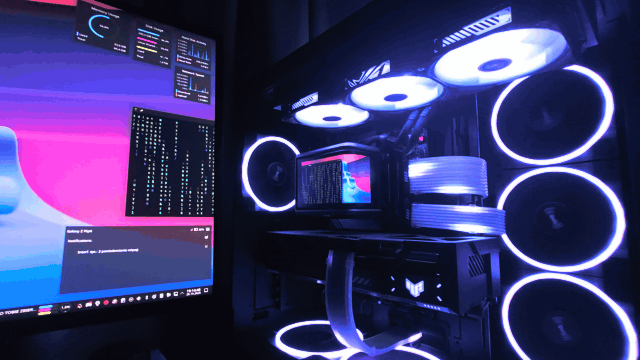
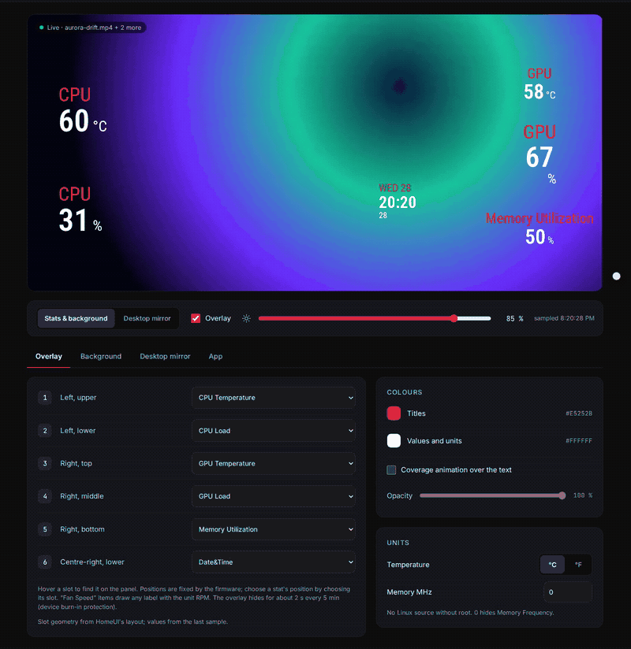
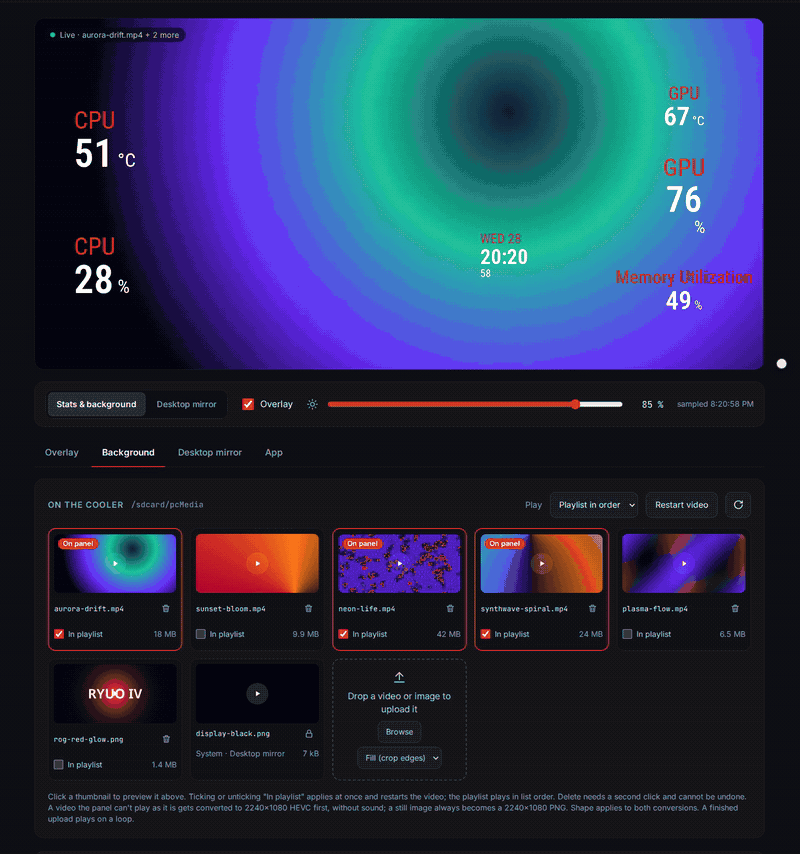
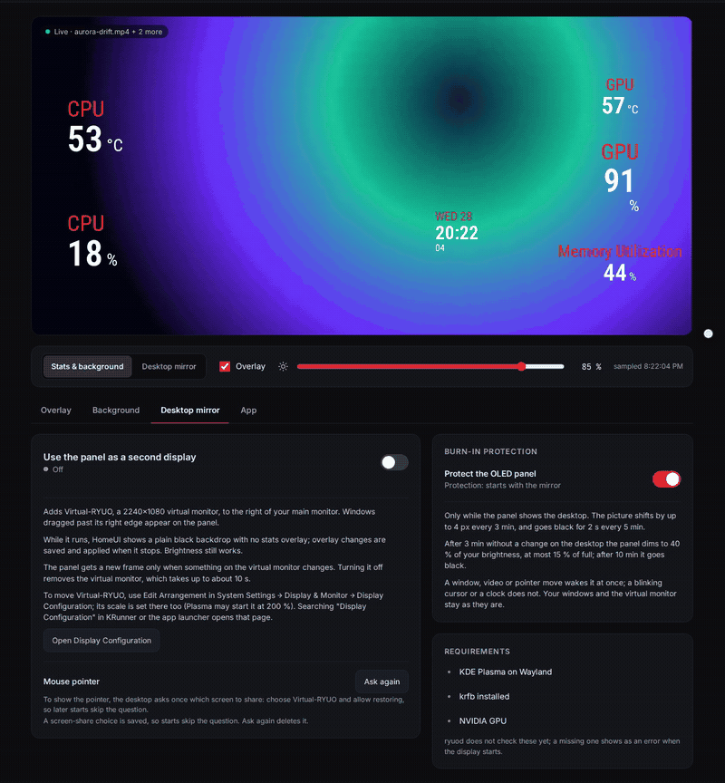
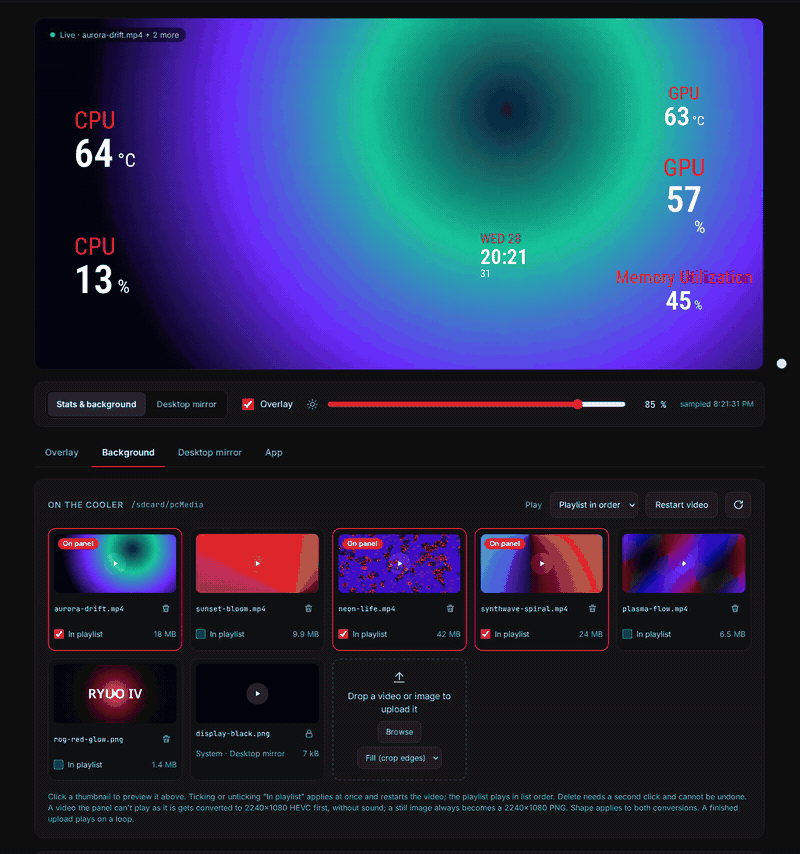

# rog-ryuo-lcd



Linux software for the 2240×1080 OLED panel on the pump of the ASUS ROG RYUO IV AIO cooler. It replaces
the Windows app for the screen: it plays videos stored on the cooler and draws live PC stats
(CPU, GPU, memory, disk, network, clock) over them, refreshed once per second. The panel shows
its standby video whenever no program has sent it a message for 5 s, so the daemon runs all the
time you are logged in.

You get:

| piece | what it does |
|---|---|
| `ryuod` (systemd user service) | keeps the panel alive, samples the stats, serves the control page on **http://127.0.0.1:8746/** |
| control page | pick stats, colours, brightness and background video in a browser; switch the panel to a second monitor |
| tray icon | show/hide stats, second display on/off, brightness, open the control page, start/stop the daemon |
| `ryuo.py` | command-line tool: device info, upload, play, stop, brightness |

Tested on one machine only: Fedora 43, KDE Plasma 6 on Wayland, cooler firmware V1.0.10.
Other distributions, desktops and firmware versions have not been tried.

## Requirements

| need | for | notes |
|---|---|---|
| Linux with systemd user sessions | the daemon | runs as `ryuod.service` under your user |
| Python 3.12 or newer at `/usr/bin/python3` | daemon, CLI, tray | the daemon and CLI use the standard library only |
| PySide6 | tray icon | Fedora: `sudo dnf install python3-pyside6`. Arch: `pyside6`. Debian 13 / Ubuntu 26.04 and later: `python3-pyside6.qtcore`, `python3-pyside6.qtgui`, `python3-pyside6.qtwidgets` (Debian splits PySide6 into one package per Qt module). Elsewhere: install PySide6 with pip for `/usr/bin/python3`. |
| `adb` (Fedora/Arch package `android-tools`, Debian/Ubuntu `adb`) | uploading videos | the daemon and the stats overlay work without it |
| `ffmpeg` and `ffprobe` with the `libx265` encoder | uploading videos the panel can't decode as they are | Fedora's own `ffmpeg-free` has no `libx265`: install `ffmpeg` from RPM Fusion (`sudo dnf swap ffmpeg-free ffmpeg --allowerasing` if `ffmpeg-free` is installed). Arch and Debian/Ubuntu `ffmpeg` include it. With a working NVIDIA GPU, `hevc_nvenc` is used instead. The service runs `/usr/bin/python3`, so the `imageio-ffmpeg` wheel in the uv environment never reaches it. |
| a StatusNotifier system tray | tray icon | KDE Plasma has one. GNOME needs the AppIndicator extension. |
| `nvidia-smi` (optional) | NVIDIA GPU stats | AMD GPUs are read from sysfs |
| KDE Plasma 6 on Wayland, an NVIDIA GPU (optional) | [second display](#second-display) | Fedora packages: `krfb`, `util-linux-core` (`unshare`), `pipewire-utils`, `pipewire-gstreamer`, `gstreamer1-plugins-base`, `gstreamer1-plugins-bad-free` (its nvcodec plugin has the `nvh265enc` encoder), `python3-gobject-base` (PyGObject), `android-tools` (adb). The encoder is NVENC, so other GPUs cannot run it. Without PyGObject the panel shows no mouse pointer, and a window moved onto the panel after the start is shown at about 1 frame/s. |
| `uv`, `node`/`npm` | development only | tests, lint, and rebuilding the control page |

`make deps` checks all of these and prints the Fedora package names for anything missing. The
second-display programs are listed separately and do not fail the check.

## Install

From the root of a clone of this repository:

```sh
make deps           # check what is installed
make install-udev   # asks for sudo: lets your user open the cooler's HID interface
make install        # no sudo: installs and starts the daemon, adds the tray launcher
```

`make help` lists every target.

What gets installed:

| file | installed by | purpose |
|---|---|---|
| `/etc/udev/rules.d/70-rog-ryuo-iv.rules` | `make install-udev` | gives the logged-in user access to `/dev/hidraw*` for USB `0b05:1c76` and `1c75:1c76` (the cooler's HID interface) |
| `~/.config/systemd/user/ryuod.service` | `make install` | runs `ryuod.py`; enabled and started |
| `~/.local/share/applications/ryuo-tray.desktop` | `make install` | "RYUO LCD" in the start menu |
| `~/.config/autostart/ryuo-tray.desktop` | `make install` | starts the tray icon at login |
| `~/.local/share/icons/hicolor/*/{apps,status}/ryuo-lcd*.svg` | `make install` | the tray and start-menu icons |

The installed unit and launchers run the code from this checkout. If you move the directory, run
`make install` again.

The two parts start at different times:

- **Daemon**: `ryuod.service` is wanted by `default.target`, so it starts when your user's systemd
  instance starts at login. It talks only to `/dev/hidraw*` and `adb` and needs no display. A
  second display switched on before logout starts once the Plasma session is up.
- **Tray**: the XDG autostart entry starts it inside the graphical session, once a tray is there
  to show it.

### Check that it worked

1. `systemctl --user status ryuod` shows `active (running)`.
2. http://127.0.0.1:8746/ opens the control page, and its status line says the cooler is connected.
3. The tray shows the pump block, in the panel's text colour (white on a dark panel). It shows a
   pointer on the pump while the panel is a second display, and is dimmed with a red dot while the
   daemon is down or the cooler is not found.
4. The pump screen shows a video with stats over it.

## Using it

### Control page (http://127.0.0.1:8746/)

| section | what you can change |
|---|---|
| Panel preview | a scaled drawing of the overlay with the latest values |
| Stats in each slot | which stat goes in each of the 6 overlay slots, and a switch to show or hide the whole overlay (hiding keeps your slot choices). Positions are fixed by the firmware, so you place a stat by choosing its slot. |
| Overlay colours | one title colour and one value/unit colour for all slots, an optional animated filter over the text, and its opacity (0–100 %) |
| Brightness | 0–102 on the device's scale: 100 gives 250/255 backlight, 102 gives the full 255/255 |
| Background media | the videos and images already on the cooler, play mode (Single, Cycle, Random). Play restarts the video. |
| Units | °C or °F, and the memory frequency in MHz (Linux has no unprivileged source for it; 0 hides that stat) |
| Second display | a switch that shows a virtual monitor of the desktop on the panel, and its state: off, starting, on with the frames/s and Mb/s sent, stopping, or the error with the next retry in seconds; a switch for burn-in protection |

The clips on this page are recorded from `npm run demo`, which serves the page with made-up data
(see [Development](#development)).





Settings are saved in `~/.config/ryuo/state.json` and restored when the daemon starts.

Stats whose label starts with "Fan Speed" (for example disk read MB/s, network KB/s) use the
firmware's fan slot, so the panel always prints "RPM" as their unit. The label carries the real unit.

### Tray menu

| item | does |
|---|---|
| status line | daemon and cooler state, product and firmware |
| Panel on | unticked, the panel shows the cooler's standby video while the daemon keeps running; ticked again, it shows your background, stats and brightness. Disabled while the panel is a second display. |
| Show stats on panel | toggles the overlay, same as the switch on the page |
| Use panel as second display | same as the second-display switch on the page; disabled while the panel is in standby |
| Brightness | in % of the full backlight; 25, 50, 75 and 100 unless you set other steps on the page |
| Open control page | opens http://127.0.0.1:8746/ |
| Start ryuod | shown only while the daemon is down; starts `ryuod.service` |
| Stop ryuod | stops the daemon; the panel shows the standby video until the daemon starts again |
| Quit tray | closes the icon; the daemon keeps running |

Left-clicking the icon opens the control page. On the page you can set it to show the menu,
switch the panel between on and standby, or show and hide the stats instead, choose up to 8
brightness steps, and turn off **Start with desktop session**, which removes
`~/.config/autostart/ryuo-tray.desktop` (`make install` adds it back). The daemon saves these
settings in `state.json`, and the tray picks them up within 3 s.

While the panel is in standby, brightness, overlay and background changes are saved and shown when
it comes back on. Standby lasts until you switch it off or the daemon restarts.

Starting "RYUO LCD" from the start menu while the tray already runs opens the control page
instead of adding a second icon.

### Second display

Turn on **Panel as monitor** under Second display on the control page (or **Use panel as second
display** in the tray). Within about 5 s the desktop gets a 2240×1080 virtual monitor named
Virtual-RYUO, and the panel shows it in place of the background video and stats overlay. Windows
dragged past the right edge of your main monitor appear on the panel, with the mouse pointer.



The first time, Plasma shows a **Share screen** dialog. Display mode captures the virtual monitor
through the desktop's screen-sharing portal, because that is the capture KWin draws the pointer
into; Plasma asks before any program may capture a screen that way. In the dialog:

1. Select **Virtual-RYUO** (not your main monitor).
2. Tick **Allow restoring on future sharing requests**.
3. Click **Share**.

The portal hands back a restore token, kept in `~/.config/ryuo/display-portal-token` (readable only
by you), so later starts, including the one at login, skip the dialog. The dialog comes back when
that token no longer works, for example after the token file was deleted or Plasma forgot the
permission. If you cancel the dialog, or nobody answers it within 120 s, the panel still shows the
virtual monitor, without the pointer, and the page says why; turning the switch off and on asks
again. To be asked again on the next start, press **Ask again** on the page, which deletes the token
(`rm ~/.config/ryuo/display-portal-token` does the same).

- The page shows the state: Starting, then On with the frames/s and Mb/s sent to the panel, averaged
  over 5 s, and whether the pointer is shown. A still desktop sends no frames, and the panel keeps
  the last one.
- Brightness keeps working, and the daemon keeps its heartbeat going. Without it the panel would drop
  to standby and to 50/255 backlight.
- While it streams, the daemon swaps the background video for a black image, `display-black.png`, with
  the stats overlay off, which lets the cooler decode the desktop at up to about 90 frames/s instead of
  about 70. Your selected background and overlay come back when display mode stops.
- **Burn-in protection** (on by default, a switch on the page) guards the OLED panel against a desktop
  that stays the same for hours. Every 3 min the picture moves to the next of 8 positions within 4 px
  of the centre. After 3 min without a real change it fades to 40 % of the current brightness, and to
  no more than 15 % of full; after 10 min it fades to black. Every 5 min it goes black for 2 s, unless it
  is already dimmed. Moving the pointer on the panel or any larger change brings the picture back at
  once; a blinking text cursor or a clock does not. The receiver on the cooler runs these timers, so
  they go on while the PC sleeps or the stream stalls. Turning the switch off or on applies within
  about a second, without restarting display mode. The backlight setting is never changed: the dimming
  draws the picture darker. The page shows the protection's state (active, dimmed, black, refresh).
- Turning it off removes the virtual monitor, which takes up to about 10 s; windows on it move to the
  main monitor. The panel then shows the background video again.
- The switch is saved in `state.json`. When the daemon starts with it on, display mode starts again,
  waiting for the Plasma session if the daemon started first.
- If it fails to start or stops on its own, the page shows the error and when the next try is. Tries
  are 5, 10, 20, 40 s apart, then every 60 s. Errors that a retry would hit again (a missing
  program, no cooler on adb) are not retried until you press **Try again now** or the cooler
  reconnects.

The daemon runs `ryuo_display.py` for this, which can also run on its own from a terminal:
`/usr/bin/python3 ryuo_display.py --help` (the daemon must have the switch off; `--no-pointer`
skips the portal and its dialog). It pushes
`receiver/receiver.jar` to the cooler over adb and streams HEVC to it; `make receiver` rebuilds
the jar.

### Command line

Run from the repository root. `./ryuo.py --help` lists the commands; `-v` prints every frame sent
and received.

| command | example | does |
|---|---|---|
| `info` | `./ryuo.py info` | prints the device's reply as JSON: firmware, serial, media files on the cooler |
| `push` | `./ryuo.py push clip.mp4` | copies a file to `/sdcard/pcMedia/` on the cooler over adb |
| `play` | `./ryuo.py play clip.mp4` | plays files already on the cooler and keeps running until stopped (Ctrl-C or `stop`); no live stats |
| `stop` | `./ryuo.py stop` | stops a running `play` or the daemon and puts the panel in standby |
| `brightness` | `./ryuo.py brightness 60` | sets the backlight, 0–100 |
| `raw` | `./ryuo.py raw POST brightness '{"value":60}'` | sends one protocol command; see [Safety](#safety) first |

`play` and the daemon cannot drive the panel at the same time; see
[Troubleshooting](#troubleshooting).

### Uploading your own video



On the control page, drop the file on the Background tab's upload zone or press **Browse**. A video
the panel can't play as it is gets converted to 2240×1080 HEVC first, without sound; a still image
becomes a 2240×1080 PNG. A finished upload plays on a loop.

From a terminal:

```sh
./ryuo.py push clip.mp4
```

Then open the control page, press **Refresh list** under Background media, select the file and
press **Play**.

For a video that fills the whole 2240×1080 panel, encode it as HEVC (H.265). H.264 is reported to
top out near 1920 px wide. That limit comes from the FoxPodZ project's findings and has not been
tested here; only H.264 MP4 files have been played on the test unit.

## Troubleshooting

| symptom | cause and fix |
|---|---|
| Panel shows the ROG logo or the standby video | Nothing is driving it. Check `systemctl --user status ryuod`; read why it stopped with `journalctl --user -u ryuod -n 30`; start it with `systemctl --user start ryuod` or the tray's **Start ryuod**. |
| After **Stop** in the tray the daemon stays stopped | `ryuod` exits with status 0 on SIGTERM, and the unit only restarts it after a failure (non-zero exit). It starts again on **Start ryuod** or at the next login. |
| The daemon stopped after running `./ryuo.py play` | Only one program can drive the panel; the newest one takes over and the other exits cleanly, so systemd does not restart the daemon. Stop `play` with `./ryuo.py stop`, then start the daemon from the tray. |
| No tray icon | The desktop has no StatusNotifier tray. On GNOME, install the AppIndicator extension. The daemon and the control page work without the tray. |
| Tray icon is blank after `make install` | Plasma looked the icon up before it was installed and does not look again. Restart the Plasma shell: `systemctl --user restart plasma-plasmashell.service` (the panel disappears for a few seconds). `make install` prints this when it adds the icons for the first time. |
| Tray still shows the old icon or menu after `make install` | `make install` restarts the daemon, not a running tray. Quit the tray from its menu and start "RYUO LCD" again. |
| Tray icon stays dark on a dark panel | The icons are not installed, so the tray sends Plasma the repo's files as pixels and Plasma cannot recolour them. The tray prints `ryuo-lcd-…-symbolic is not installed` to stderr. Run `make install`, then quit and restart the tray. |
| `Permission denied` on `/dev/hidraw*`, or "RYUO IV HID interface not found" | The udev rule is missing or not applied yet. Run `make install-udev`, then unplug and replug the cooler's USB header (or reboot), or run `sudo udevadm trigger`. |
| Daemon exits with `cannot bind 127.0.0.1:8746` | Another program uses port 8746, which the tray and the page expect. Free the port; systemd retries every 5 s. |
| The stats overlay disappears for about 2 s every 5 min | The cooler's own burn-in protection plays a short screensaver clip. The firmware resets that timer only by restarting the video, so the daemon leaves it on. |
| Second display: "no Wayland session yet" | The daemon found no `wayland-N` socket in `$XDG_RUNTIME_DIR`: Plasma has not started yet (it retries), or the session is X11, which display mode does not support. |
| Second display: "no PipeWire stream for Virtual-RYUO after 10 s" | KWin did not start the virtual monitor's screencast stream. Seen once on the test machine, where the journal showed `kwin_wayland: GL_OUT_OF_MEMORY ... Failed to allocate memory for texture`; the retry 5 s later worked. |
| Second display: "krfb-virtualmonitor already serves Virtual-RYUO" | Another `ryuo_display.py` is running, for example one started from a terminal or one still stopping. The daemon retries; stop the other one if it keeps running. |
| Second display: the panel dims or goes black while I read | Burn-in protection: 3 min without a real change dims it, 10 min blacks it. Move the pointer on the panel to bring it back, or turn **Burn-in protection** off on the page. |
| Second display: "no cooler on adb" or "missing programs" | Not retried by itself. Check `adb devices` or run `make deps`, then press **Try again now**. |
| After display mode the panel says "Can't play this video.", or display mode never shows a first frame | The cooler's hardware decoder was left allocated, usually because the receiver was killed before it released it. Run `adb shell setprop ctl.restart android-hardware-media-c2-hal-1-1`. If it happens after stopping `ryuod.service`, the installed unit predates `KillMode=mixed`, which makes systemd signal only the daemon so it can stop display mode in order: run `make install` again. |
| Cooler not found on another firmware | The HID interface is matched by product ID `1c76` with vendor `0b05` (firmware 1.0.3 and 1.0.10) or `1c75` (firmware 1.0.7, per other projects). Only V1.0.10 has been tested. `lsusb` shows the IDs your unit reports; the test unit lists `0b05:1c76 ASUSTek Computer, Inc. ROG RYUO IV Standard`. |

## Safety

The cooler is an Android device with a root `adb` shell, reachable over its internal USB
connection. Treat both interfaces with care:

- Never send `upgrade`, or `transport`/`transported` with `"type":"firmware"`, through
  `ryuo.py raw`. They start a firmware update.
- Never send `rotate`. It writes a persistent device property and is untested. The `raw` help text
  uses `rotate` as its example; do not run it.
- `adb shell` on the cooler runs as root and can change or delete files on the device.

The control page and API listen on `127.0.0.1` only and reject requests whose `Host` header is not
`127.0.0.1:8746` or `localhost:8746`.

## Development

```sh
make test            # Python tests (uv run pytest) and web tests (npm, in web/)
make build-frontend  # rebuild web/dist/ from web/src/
make lint
make format
make run             # the daemon in the foreground with -v
make tray            # the tray icon
```

ryuod serves the control page from `web/dist/`, which is committed, so an install needs no node.
After changing anything under `web/src/`, run `make build-frontend` and commit `web/dist/` with the
change: `make test` fails while `web/dist/` differs from a fresh build. For working on the page,
`npm run dev` in `web/` serves it at http://127.0.0.1:5173/ with live reload and passes `/api`
requests to the running ryuod on port 8746. `npm run demo` serves the same page with made-up data
instead (`web/demo/mock-api.ts`): sample clips, live-looking stats, uploads and the second display,
all in memory, with nothing sent to ryuod or the cooler. Use it to record the page.

`make run` refuses while `ryuod.service` is active, because both would want port 8746. Stop the
service first (`systemctl --user stop ryuod`, or Stop in the tray) and start it again when you are
done.

`make uninstall` removes the user service, launchers and icons. It keeps the udev rule and
`~/.config/ryuo/state.json`, and prints how to remove them.

| path | contents |
|---|---|
| `ryuo_proto.py` | frame codec, HID device class, message builders, pidfile helpers; shared by the daemon and the CLI |
| `ryuod.py` | the daemon: device worker, stats sampler, HTTP server and JSON API |
| `ryuo_display.py` | the second display: virtual monitor, HEVC encoder and stream to the cooler; the daemon runs it while the switch is on |
| `receiver/` | `RyuoDisplay.java`, the on-device stream receiver, and its built `receiver.jar` |
| `ryuo_media.py` | uploads for the daemon: ffprobe check, transcode to HEVC when the panel can't decode the file, still images to a 2240×1080 PNG, adb push |
| `ryuo.py` | the CLI |
| `ryuo_tray.py` | the tray icon; talks only to the daemon's HTTP API |
| `web/` | the control page (Lit + TypeScript, built with Vite into `web/dist/`, which is committed) and its tests |
| `tests/` | Python tests |
| `packaging/` | templates for the systemd unit and the desktop entry; `icons/`, the hicolor icon theme files |
| `70-rog-ryuo-iv.rules` | the udev rule |
| `docs/001-lcd-protocol/` | the reverse-engineered HID protocol: frame format, commands, device quirks |
| `docs/002-stats-prototype/` | daemon design: stat sources, overlay slots, startup and reconnect sequence, HTTP API |
| `docs/009-burn-in/` | the second display's burn-in protection: timers, what counts as a change, how to tune it |
| `docs/010-frontend-stack/` | the control page in Lit, TypeScript and Vite: the design, the build, what changed from the old page |
| `re/` | local reverse-engineering material (vendor APKs, decompiled sources, screenshots); git-ignored |

How the protocol works, in short: video files go to the cooler over adb; commands go over a HID
interface as framed text messages in 1024-byte reports; the panel returns to standby 5 s after the
last message, so the daemon sends a stats heartbeat every second.

## Credits

Prior work on the same cooler, read during the reverse engineering:

- https://github.com/FoxPodZ/ryuo-iv-screen
- https://github.com/dragocz95/asus-ryuo-iv-linux

This project is not affiliated with or endorsed by ASUS.

No license has been chosen yet.
